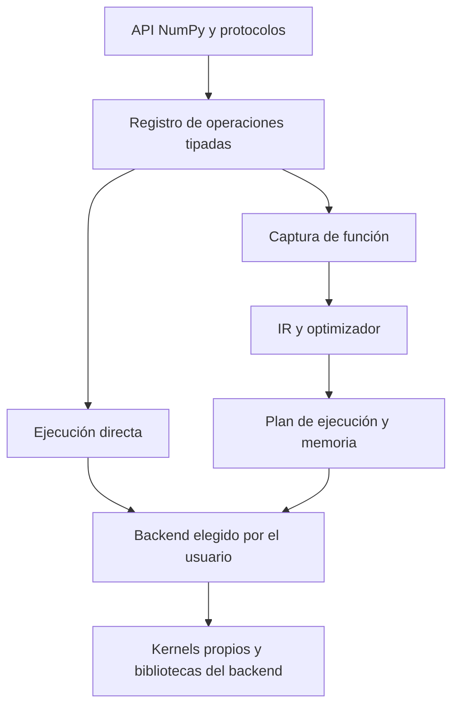

# Propuesta de arquitectura de ejecución

Estado: **arquitectura aceptada; primera implementación**, 2026-09-06.
La API `compile`, su decorador, planes reutilizables y el backend Vulkan ya están
implementados. El resto de este documento conserva la arquitectura objetivo;
no implica que todas sus optimizaciones o garantías futuras estén implementadas.
Consulta [el contrato actual del compilador](compilation.md) y
[el backend Vulkan](vulkan.md).

## Alcance y prioridades acordadas

El objetivo es abstraer kernels, dispatches, colas y memoria de GPU, conservando
código NumPy reconocible en un subconjunto útil. **No se persigue compatibilidad
100 % con NumPy.** Priorizamos frecuencia de uso en cálculo matricial, ganancia
medida y coste de implementación. La CPU sigue disponible para entradas pequeñas;
no se abandona su corrección ni se promete que una GPU gane por tamaño de datos.

- Ahora: operaciones densas frecuentes, planes cacheados, fusión, reducciones,
  productos, pasos iterativos, CLBlast y ejecución real OpenCL/Vulkan.
- Después, según evidencia: GEMV/DOT optimizados, map-reduce fusionado, pooling y
  fusión Vulkan, matmul por lotes y más operaciones de alto uso.
- Sin prioridad inmediata: vistas mutables y aliasing completos, compilación
  general de Python, compatibilidad de poco uso y mucha dificultad.
- Deuda futura: dispersas y precondicionadores. CUDA está previsto como backend
  posterior; hoy cuBLAS, CuPy y nvmath-python son referencias de benchmark.

El usuario elige backend y dispositivo; optimizar no autoriza cambiarlos.
CLBlast sigue siendo una implementación reemplazable de operaciones OpenCL.

## Decisión recomendada

Mantener una API con semántica NumPy y ejecución directa por defecto, apoyada en
un registro único de operaciones. Añadir compilación opcional de funciones sobre
una representación intermedia tipada, con planes reutilizables y fusión como
optimización interna. El backend y dispositivo son elecciones del usuario.

El grafo diferido vive dentro de una captura explícita, no como estado pendiente
global de todos los arrays públicos. La salida de una función compilada vuelve
a ser un array ordinario de OpenPacho, con su trabajo encolado. Encolar no equivale
a esperar ni a descargarlo al host.

La ejecución directa sigue siendo el camino de compatibilidad y depuración. El
modo compilado acepta un subconjunto definido; no exige que toda función nueva
tenga inmediatamente un kernel fusionado. Ambos comparten operaciones, reglas de
tipos y backends; no son dos bibliotecas independientes.

## Qué problema estamos resolviendo

Eager, lazy y compilación no son tres alternativas del mismo nivel. Eager/lazy
deciden cuándo ejecutar; la captura decide qué fragmento podemos analizar; la
compilación produce un plan especializado; la fusión combina operaciones dentro
de ese plan. La residencia y las transferencias son otra decisión del runtime.

OpenPacho ya mantiene arrays en dispositivo entre llamadas eager. La transferencia
no es una consecuencia inevitable de eager. Las mediciones muestran costes de
asignación, despacho, trazado y sincronización además de las copias. Cambiar a
lazy por sí solo tampoco elimina una lectura escalar exigida por Python.

El decorador `fuse` original es un prototipo útil de captura y generación de código, pero
traza la función de nuevo en cada llamada. Se almacena el programa OpenCL; no se
reutiliza todavía un plan de función que evite el trazado. Además, se duplican
algunas reglas entre `_array.py` y `_fusion.py`, y el generador conoce directamente
expresiones OpenCL. Extender ese diseño por operación y fabricante multiplicaría
el mantenimiento.

## Alternativas consideradas

| Opción | Ventaja principal | Compromiso para este proyecto | Decisión |
| --- | --- | --- | --- |
| Solo eager | Flujo Python natural y errores fáciles de localizar | Poco contexto para optimizar varias operaciones juntas | Conservar como base, insuficiente como única estrategia |
| Solo `fuse` elemento a elemento | Implementación pequeña y ganancias rápidas | Se queda corto para reducciones, álgebra y planes iterativos | Conservar compatibilidad, convertirlo en consumidor del núcleo común |
| Lazy automático global | Fusiona entre líneas y funciones sin envolverlas | Vistas, escrituras, observaciones, memoria retenida y tiempos de error exigen un runtime más complejo | No adoptarlo por defecto |
| Contexto lazy acotado | Amplía la captura sin compilar Python arbitrario | Sigue trazando el cuerpo; necesita contratos de efectos, salidas y límites del grafo | Posible experimento posterior sobre el mismo IR, no otra API inicial |
| Compilación opcional de funciones | Planes reutilizables y optimización de varias clases de operaciones | Debe definir qué Python captura y qué no | Camino recomendado |
| Compilador general de Python con reanudación tras cortes | Puede preservar más flujo Python automáticamente | Infraestructura de captura, guards, efectos y compatibilidad con CPython muy costosa | No construirlo en esta etapa |

ArrayFire demuestra que la fusión lazy entre llamadas es viable; no es un modelo
incorrecto. Su JIT agrega operaciones y evalúa al pedirlo o al llegar a una
operación no cubierta. Para OpenPacho, elegir ese modelo como contrato público
trasladaría buena parte del esfuerzo a preservar la semántica de arrays mutables.
[Documentación de ArrayFire](https://arrayfire.org/docs/jit.htm).

JAX demuestra el valor de una representación de primitivas y funciones compiladas,
pero sus transformaciones se diseñan para funciones puras y su control de flujo
trazado tiene restricciones. Adoptar esa infraestructura como inspiración no
implica adoptar sus diferencias de API respecto a NumPy.
[JIT de JAX](https://docs.jax.dev/en/latest/jit-compilation.html).

## Contrato de intercambiabilidad

Intercambiabilidad significa tres cosas distintas que deben probarse por separado:

1. **Expresiones:** operadores y funciones compatibles se escriben igual.
2. **Comportamiento:** formas, tipos, broadcasting, valores, vistas y escrituras
   respetan el contrato anunciado. Conservar una firma no basta.
3. **Integración:** una dependencia acepta el objeto array y sus protocolos.
   Una extensión que exige memoria NumPy en CPU no se convierte automáticamente
   en una función GPU por añadir un compilador.

Se conservan `__array_ufunc__` y `__array_function__`. Se propone añadir
`__array_namespace__` y una cobertura comprobada del Array API para código nuevo
que ya use ese protocolo. Ese estándar complementa el contrato NumPy; no cubre
por sí solo todo NumPy ni elimina las fronteras de transferencia.
[Despacho NumPy](https://numpy.org/doc/stable/user/basics.dispatch.html),
[Array API en NumPy](https://numpy.org/doc/stable/reference/array_api.html).

Para acercarnos al flujo Python de NumPy, las conversiones a un valor Python
(`bool`, `float`, `int`) deberían seguir sus reglas cuando sean válidas. En GPU
esa observación solicitada por el programa necesita sincronización y lectura
del valor; debe aparecer en el perfil de ejecución. No es un cambio de backend.
Esto supone evolucionar el rechazo actual de toda conversión booleana, con
pruebas de los casos válidos y ambiguos. La conversión implícita de un array
completo mediante `np.asarray` seguiría siendo una frontera distinta y rechazada:
se usa `asnumpy` cuando realmente se necesita memoria CPU.

Ejemplo de API **implementada**, sin cambiar el cuerpo de la función:

```python
import numpy as np
import openpacho as pacho


def energia(a, b, c):
    x = a * b + c
    y = 2 * x
    return np.sum(y * y, axis=-1)


# Camino original, con arrays NumPy.
cpu = energia(a_host, b_host, c_host)

# La optimización se aplica desde fuera del algoritmo.
energia_compilada = pacho.compile(energia)
with pacho.use_backend("opencl"):
    a = pacho.asarray(a_host)
    b = pacho.asarray(b_host)
    c = pacho.asarray(c_host)
    gpu = energia_compilada(a, b, c)
    resultado = pacho.asnumpy(gpu)
```

También se admiten `@pacho.compile` y `@pacho.compile()`:

```python
@pacho.compile
def energia(a, b, c):
    x = a * b + c
    y = 2 * x
    return np.sum(y * y, axis=-1)
```

Las tres formas usan el mismo compilador. Con inputs NumPy, el decorador ejecuta
la función original; con arrays OpenPacho, usa su backend y un plan cacheado.

El `return` delimita el plan compilado; las asignaciones `x` e `y` no lo delimitan.
La reducción puede requerir varios kernels. Una función compilada no promete
un solo kernel. Si se devuelven `x` e `y`, ambos son resultados observables y el
plan debe producirlos, aunque pueda compartir trabajo.

Los creadores NumPy sin argumentos array no siempre pasan por protocolos de
despacho. Su soporte dentro de una captura necesita reglas explícitas; no se
promete que cualquier llamada `np.*` funcione en GPU. Para constructores internos
portables se podrá usar el namespace del array o funciones como `zeros_like`.

## Por qué no hacer todos los arrays lazy

Considérese este contrato NumPy, aunque OpenPacho todavía no implemente escrituras:

```python
x = a * b + c
a[:] = 0
y = 2 * x
```

`x` debe conservar el resultado calculado con el valor anterior de `a`. Un grafo
que conserve una referencia al mismo almacenamiento mutable y lo lea al final
produciría otro resultado. Se puede resolver con versiones de almacenamiento,
dependencias de escritura, materialización o copias, pero no ignorarlo.

Las vistas también importan: `v = a[:, 0]` comparte datos en NumPy, mientras el
slicing actual de OpenPacho copia. Antes de prometer más compatibilidad hay que
definir un descriptor de almacenamiento con forma, strides, offset, identidad
compartida, permisos y dependencias. La futura semántica pública puede ser mutable
aunque los valores internos del IR se representen de forma inmutable.
[Copias y vistas de NumPy](https://numpy.org/doc/stable/user/basics.copies.html).

Lazy global también debe controlar la memoria retenida por grafos largos, cuándo
se reportan errores y qué valores deben conservarse al ejecutar solo parte del
grafo. Un límite de tamaño resuelve crecimiento, pero no el contrato de aliasing.
Por eso lo pospondría hasta tener el modelo de almacenamiento y efectos probado.

## Núcleo común y responsabilidades



**Registro de operaciones.** Cada primitiva define inferencia de forma/dtype,
promoción de escalares débiles de NumPy 2, validación, aliasing/efectos y semántica.
Puede declarar descomposición en otras primitivas, una implementación directa y
reglas de generación de código. La ruta eager usa ese contrato sin construir un
grafo de función por cada suma; el coste fijo debe medirse y mantenerse pequeño.

**IR tipado.** Nodos independientes de OpenCL: operaciones elemento a elemento,
reducciones, productos, vistas, lectura/escritura y llamadas opacas conocidas.
Representa múltiples salidas, dependencias de efectos y constantes frente a
argumentos dinámicos. Sus interfaces deben admitir regiones de control de flujo
futuras sin fingir que ya podemos capturar cualquier `while` de Python.

**Optimizador.** Elimina trabajo muerto cuando es semánticamente válido, comparte
expresiones puras y particiona el grafo en grupos fusionables. Puede fusionar una
expresión con una reducción, mantener una llamada BLAS y reusar almacenamiento
de temporales cuya vida terminó. No debe reasociar flotantes o bajar precisión
sin una política explícita. Reusar memoria no permite sobrescribir inputs o
salidas todavía observables.

**Plan de ejecución.** Contiene argumentos, buffers temporales, kernels, llamadas
externas y dependencias. Se instancia por invocación para que llamadas concurrentes
no compartan temporales vivos. Evita retrazar Python al reutilizarlo. Inicialmente
puede ejecutarse desde Python; un ejecutor nativo o grabación de comandos sería
una mejora posterior según capacidades, no un requisito universal del backend.

**Backend.** Describe capacidades reales por operación, dtype y layout, administra
colas/memoria y ejecuta los pasos. OpenCL/Vulkan/CUDA son destinos distintos;
añadir uno requiere implementar sus primitivas o descomposiciones, no solo un
traductor textual. El IR y los algoritmos de alto nivel se reutilizan. CPU
puede comenzar ejecutando primitivas NumPy; compilar un grafo en ese backend no
promete por sí solo mejorar NumPy.

Se deben separar tres conceptos: backend/dispositivo, modo de ejecución y
proveedor de una operación. CLBlast no es un dispositivo. En la arquitectura
objetivo, cambiar `custom` por `clblast` debería cambiar la política del plan sin
crear un contexto incompatible ni copiar arrays que ya están en la misma GPU.
Esto requiere separar la identidad del contexto de la política BLAS; la versión
actual aún crea objetos/contextos distintos por configuración.

## CLBlast y kernels propios

CLBlast es una implementación de operaciones del backend OpenCL, no el contrato
del IR ni el único camino de álgebra. El IR conserva una operación `matmul`;
su plan puede llamar a CLBlast o a un kernel propio según la política explícita.

Una llamada CLBlast es normalmente una frontera de fusión. Sin embargo, una
operación BLAS ya puede expresar ciertos patrones (por ejemplo, los parámetros
alpha/beta de GEMM). Solo se sustituye un patrón por esa operación si se respetan
tipos, redondeo, aliasing y efectos definidos. Un kernel específico puede combinar
más pasos cuando resulte útil. Ambas implementaciones comparten pruebas y
benchmarks. La selección interna de una implementación no cambia el dispositivo.

Se conserva el control `custom`/`clblast` para comparar. Cualquier futura selección
automática de kernels dentro del backend debe ser inspeccionable y anulable; no
autoriza migración automática a CPU/CUDA ni cambios de precisión.

## Contrato del primer compilador

- Captura inicial: funciones numéricas puras, formas estáticas por especialización,
  argumentos array/scalar y varias salidas. No se exige un único kernel.
- Cachear **planes**, además de kernels. Las claves y guards consideran función,
  metadatos relevantes, layout, dtype, escalares estáticos declarados, backend,
  dispositivo/capacidades, opciones numéricas y versiones que invalidan el binario.
- Los escalares dinámicos y buffers se enlazan en cada llamada. No se cachean
  valores de datos ni direcciones como sustituto de argumentos. Las capturas
  mutables se pasan explícitamente o se rechazan; no se congelan silenciosamente.
- Cambios de forma o argumentos estáticos pueden crear otra variante, con límites
  de caché y diagnósticos. Primero se soportan formas concretas; polimorfismo de
  formas queda para después de medir la recompilación real.
- Una primitiva conocida sin regla de fusión puede ejecutarse como una llamada
  individual del mismo backend dentro del plan. No equivale a ejecutar Python
  arbitrario fuera de la captura.
- Python no capturable, mutación aún no soportada y lecturas host dentro de la
  función producen un error de compilación identificable. El usuario conserva la
  función original para ejecutarla de forma directa. No se vuelve a ejecutar
  automáticamente un cuerpo que pudo haber realizado efectos durante el trazado.
- La función compilada admite solo las garantías de pureza documentadas; el
  trazado por sobrecarga no puede detectar todo efecto Python. Las pruebas y los
  diagnósticos no deben presentarlo como un verificador completo de pureza.
- Los errores de compilación/dispositivo y sus ubicaciones deben ser visibles.
  Un método de inspección debería mostrar grupos fusionados, BLAS, buffers,
  puntos de sincronización y motivos de especialización.

PyTorch logra continuar tras Python no capturable mediante cortes del grafo y
reanudación. Es una posibilidad futura, pero exige infraestructura adicional de
captura de Python; no aparece gratis por implementar un DAG de arrays.
[Graph breaks en PyTorch](https://docs.pytorch.org/docs/main/user_guide/torch_compiler/compile/programming_model.graph_breaks_index.html).

## Solvers y control de flujo

El primer objetivo de compilación en solvers debe ser el cuerpo de la iteración.
La decisión de parada puede seguir en Python y comprobarse con la misma frecuencia.
Una condición Python sobre un escalar GPU sigue necesitando sincronización.

Mover un bucle completo requiere representar su estado, condiciones, orden de
efectos y diagnóstico de convergencia. No basta con fusionar cien expresiones ni
desenrollar sin límite un bucle al trazarlo. Un bucle con dimensiones estáticas y
número de iteraciones acotado puede tener otras estrategias, pero debe evaluarse
sin cambiar tolerancias o frecuencia de parada a espaldas del usuario.

Mantener control de flujo Python en el camino directo preserva más código NumPy.
Las restricciones del compilador son optativas y locales. No se propone exigir
una API de actualización funcional tipo `.at[...]` a todos los usuarios.
[Mutación y control de flujo en JAX](https://docs.jax.dev/en/latest/notebooks/Common_Gotchas_in_JAX.html).

## Orden de implementación y criterios de avance

1. **Contrato y modelo de datos:** fijar el subconjunto de tipos, formas,
   observaciones host y errores. Posponer vistas mutables y escrituras complejas. Mantener explícitas las diferencias
   actuales; no declarar resuelto el slicing por documentación.
2. **Registro único e IR:** trasladar reglas compartidas de `_array.py` y
   `_fusion.py`, con pruebas de conformidad y medidas del coste eager. Hacer que
   `fuse` use el mismo núcleo sin romper sus llamadas existentes.
3. **Planes compilados reutilizables:** `compile(f)` y decoradores, salidas múltiples,
   captura de expresiones/reducciones/álgebra y límites claros de pureza. Un
   producto puede seguir siendo BLAS aunque lo rodeen kernels fusionados.
4. **Optimización guiada por medidas:** map-reduce, gestión de temporales,
   GEMV/DOT, cuerpos de iteración y posterior ejecutor nativo si Python domina.
5. **Extensión:** más operaciones, dtypes y layouts con capacidades comprobadas;
   segundo fabricante real antes de prometer portabilidad de rendimiento. Nuevos
   backends se conectan al mismo contrato. Sparse/precondicionadores siguen como deuda.

Para añadir una operación: definir y probar semántica una vez; aportar ejecución
en los backends anunciados o descomposición válida; luego añadir optimizaciones
opcionales. Una función nueva no debería exigir modificar manualmente cada tracer.

Los criterios de aceptación incluyen comparar función NumPy/directa/compilada,
tipos mixtos, escalares que cambian entre llamadas, layouts, salidas múltiples,
inputs reutilizados, aliasing/escrituras cuando se soporten, errores y concurrencia.
Los benchmarks deben separar captura/compilación fría, plan caliente, transferencias,
memoria máxima y bucles con convergencia. Una mejora no se valida solo contando
menos kernels ni permitiendo una precisión distinta.

## Fuera de esta decisión

No se promete compilar Python arbitrario, interoperabilidad binaria universal con
SciPy/pandas, autodiferenciación ni sistemas distribuidos. Vulkan sí forma parte
de esta etapa; un backend CUDA queda para más adelante.
MLIR/XLA u otro compilador podrían evaluarse detrás del IR si sus destinos y coste
de distribución encajan; no se escogen aquí como dependencia obligatoria. El
primer objetivo es fijar un contrato de operaciones y planes suficientemente
pequeño y comprobable, evitando reinventar un compilador general de Python.
