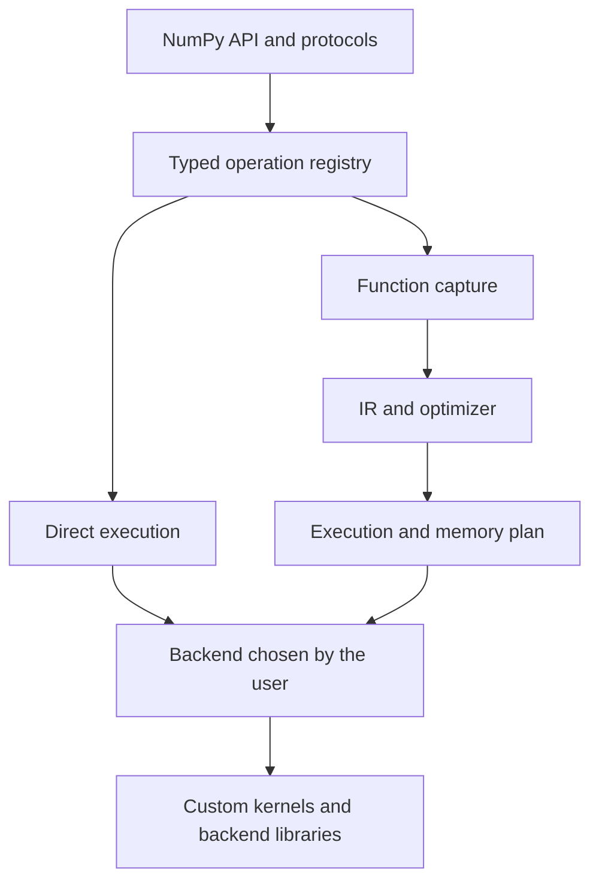

# Execution architecture proposal

Status: **accepted architecture; initial implementation**, 2026-09-06.
The `compile` API, its decorator, reusable plans, and the Vulkan backend are
already implemented. The rest of this document preserves the target architecture;
it does not imply that all its optimizations or future guarantees are implemented.
See [the current compiler contract](compilation.md) and
[the Vulkan backend](vulkan.md).

## Agreed scope and priorities

The goal is to abstract GPU kernels, dispatches, queues, and memory while preserving
recognizable NumPy code within a useful subset. **100% NumPy compatibility is
not a goal.** We prioritize frequency of use in matrix computation, measured gains,
and implementation cost. The CPU remains available for small inputs;
its correctness is preserved, and data size alone does not guarantee a GPU win.

- Now: common dense operations, cached plans, fusion, reductions,
  products, iterative steps, CLBlast, and actual OpenCL/Vulkan execution.
- Later, as evidence warrants: optimized GEMV/DOT, fused map-reduce, pooling and
  Vulkan fusion, batched matmul, and more frequently used operations.
- No immediate priority: full mutable views and aliasing, general
  Python compilation, and rarely used compatibility features that are hard to implement.
- Future debt: sparse operations and preconditioners. CUDA is planned as a
  later backend; today cuBLAS, CuPy, and nvmath-python are benchmark references.

The user chooses the backend and device; optimization does not authorize changing them.
CLBlast remains a replaceable implementation of OpenCL operations.

## Recommended decision

Keep an API with NumPy semantics and direct execution by default, backed by
a single operation registry. Add optional function compilation over
a typed intermediate representation, with reusable plans and fusion as an
internal optimization. The backend and device are user choices.

The deferred graph lives within an explicit capture, rather than as global
pending state for all public arrays. A compiled function's output is once again
an ordinary OpenPacho array, with its work enqueued. Enqueuing does not mean
waiting or downloading it to the host.

Direct execution remains the compatibility and debugging path. Compiled
mode accepts a defined subset; it does not require every new function to have
a fused kernel immediately. Both share operations, type rules, and
backends; they are not two independent libraries.

## The problem we are solving

Eager execution, lazy execution, and compilation are not three alternatives at the same level. Eager/lazy
determine when to execute; capture determines which portion we can analyze;
compilation produces a specialized plan; fusion combines operations within
that plan. Residency and transfers are another runtime decision.

OpenPacho already keeps arrays on the device between eager calls. Transfer
is not an inevitable consequence of eager execution. Measurements show allocation,
dispatch, tracing, and synchronization costs in addition to copies. Switching to
lazy execution alone does not eliminate a scalar read required by Python either.

The original `fuse` decorator is a useful capture and code-generation prototype, but
it retraces the function on every call. The OpenCL program is cached; a function
plan that avoids tracing is not yet reused. In addition, some rules are duplicated
between `_array.py` and `_fusion.py`, and the generator directly knows
OpenCL expressions. Extending that design by operation and vendor would multiply
maintenance work.

## Alternatives considered

| Option | Main advantage | Tradeoff for this project | Decision |
| --- | --- | --- | --- |
| Eager only | Natural Python flow and easily located errors | Little context for optimizing multiple operations together | Keep as the foundation; insufficient as the sole strategy |
| Elementwise `fuse` only | Small implementation and quick gains | Falls short for reductions, algebra, and iterative plans | Preserve compatibility; make it a consumer of the shared core |
| Global automatic lazy execution | Fuses across lines and functions without wrapping them | Views, writes, observations, retained memory, and error timing require a more complex runtime | Do not adopt by default |
| Bounded lazy context | Extends capture without compiling arbitrary Python | Still traces the body; needs contracts for effects, outputs, and graph boundaries | Possible later experiment on the same IR, not another initial API |
| Optional function compilation | Reusable plans and optimization across several operation classes | Must define which Python constructs it captures | Recommended path |
| General Python compiler with resumption after breaks | Can automatically preserve more Python flow | Very costly capture, guard, effect, and CPython compatibility infrastructure | Do not build at this stage |

ArrayFire demonstrates that lazy fusion across calls is viable; it is not an
incorrect model. Its JIT aggregates operations and evaluates on request or when
it reaches an unsupported operation. For OpenPacho, choosing that model as the
public contract would shift much of the effort toward preserving mutable-array semantics.
[ArrayFire documentation](https://arrayfire.org/docs/jit.htm).

JAX demonstrates the value of a representation based on primitives and compiled functions,
but its transformations are designed for pure functions and its traced control
flow has restrictions. Taking inspiration from that infrastructure does not
imply adopting its API differences from NumPy.
[JAX JIT](https://docs.jax.dev/en/latest/jit-compilation.html).

## Interchangeability contract

Interchangeability means three distinct things that must be tested separately:

1. **Expressions:** compatible operators and functions are written the same way.
2. **Behavior:** shapes, types, broadcasting, values, views, and writes
   follow the advertised contract. Preserving a signature is not enough.
3. **Integration:** a dependency accepts the array object and its protocols.
   An extension that requires NumPy memory on the CPU does not automatically
   become a GPU function by adding a compiler.

`__array_ufunc__` and `__array_function__` are retained. Adding
`__array_namespace__` and verified Array API coverage is proposed for new code
that already uses that protocol. That standard complements the NumPy contract;
it does not cover all of NumPy on its own or remove transfer boundaries.
[NumPy dispatch](https://numpy.org/doc/stable/user/basics.dispatch.html),
[Array API in NumPy](https://numpy.org/doc/stable/reference/array_api.html).

To approach NumPy's Python workflow, conversions to a Python value
(`bool`, `float`, `int`) should follow its rules when valid. On the GPU,
that observation requested by the program requires synchronization and reading
the value; it must appear in the execution profile. It is not a backend change.
This requires evolving the current rejection of all Boolean conversions, with
tests for valid and ambiguous cases. Implicit conversion of an entire array
through `np.asarray` would remain a separate, rejected boundary:
use `asnumpy` when CPU memory is actually needed.

Example of the **implemented** API, without changing the function body:

```python
import numpy as np
import openpacho as pacho


def energy(a, b, c):
    x = a * b + c
    y = 2 * x
    return np.sum(y * y, axis=-1)


# Original path, with NumPy arrays.
cpu = energy(a_host, b_host, c_host)

# Optimization is applied from outside the algorithm.
compiled_energy = pacho.compile(energy)
with pacho.use_backend("opencl"):
    a = pacho.asarray(a_host)
    b = pacho.asarray(b_host)
    c = pacho.asarray(c_host)
    gpu = compiled_energy(a, b, c)
    result = pacho.asnumpy(gpu)
```

`@pacho.compile` and `@pacho.compile()` are also supported:

```python
@pacho.compile
def energy(a, b, c):
    x = a * b + c
    y = 2 * x
    return np.sum(y * y, axis=-1)
```

All three forms use the same compiler. With NumPy inputs, the decorator runs
the original function; with OpenPacho arrays, it uses their backend and a cached plan.

The `return` bounds the compiled plan; assignments to `x` and `y` do not.
The reduction may require multiple kernels. A compiled function does not promise
a single kernel. If `x` and `y` are returned, both are observable results and the
plan must produce them, although it may share work.

NumPy constructors without array arguments do not always go through dispatch
protocols. Supporting them within a capture requires explicit rules;
there is no promise that any `np.*` call will work on the GPU. For portable internal
constructors, the array namespace or functions such as `zeros_like` could be used.

## Why not make all arrays lazy

Consider this NumPy contract, even though OpenPacho does not yet implement writes:

```python
x = a * b + c
a[:] = 0
y = 2 * x
```

`x` must preserve the result computed with the previous value of `a`. A graph
that retains a reference to the same mutable storage and reads it at the end
would produce a different result. Storage versioning, write dependencies,
materialization, or copies can solve this, but it cannot be ignored.

Views also matter: `v = a[:, 0]` shares data in NumPy, whereas
OpenPacho's current slicing copies. Before promising more compatibility, a
storage descriptor must be defined with shape, strides, offset, shared identity,
permissions, and dependencies. Future public semantics may be mutable
even if internal IR values are represented immutably.
[NumPy copies and views](https://numpy.org/doc/stable/user/basics.copies.html).

Global lazy execution must also control the memory retained by long graphs, when
errors are reported, and which values must survive when only part of the graph
is executed. A size limit handles growth, but not the aliasing contract.
That is why I would postpone it until the storage and effect model has been tested.

## Shared core and responsibilities



**Operation registry.** Each primitive defines shape/dtype inference,
NumPy 2 weak-scalar promotion, validation, aliasing/effects, and semantics.
It may declare a decomposition into other primitives, a direct implementation,
and code-generation rules. The eager path uses this contract without building a
function graph for every addition; the fixed cost must be measured and kept small.

**Typed IR.** OpenCL-independent nodes: elementwise operations,
reductions, products, views, reads/writes, and known opaque calls.
It represents multiple outputs, effect dependencies, and constants versus
dynamic arguments. Its interfaces must allow future control-flow regions
without pretending that any Python `while` can already be captured.

**Optimizer.** Eliminates dead work when semantically valid, shares
pure expressions, and partitions the graph into fusible groups. It can fuse an
expression with a reduction, retain a BLAS call, and reuse storage
for temporaries whose lifetimes have ended. It must not reassociate floating-point
operations or reduce precision without an explicit policy. Memory reuse does not
allow overwriting inputs or outputs that are still observable.

**Execution plan.** Contains arguments, temporary buffers, kernels, external
calls, and dependencies. It is instantiated per invocation so concurrent calls
do not share live temporaries. Reuse avoids retracing Python. Initially,
it can execute from Python; a native executor or command recording would be
a later improvement according to capabilities, not a universal backend requirement.

**Backend.** Describes actual capabilities by operation, dtype, and layout, manages
queues/memory, and executes the steps. OpenCL/Vulkan/CUDA are distinct targets;
adding one requires implementing its primitives or decompositions, not merely a
textual translator. The IR and high-level algorithms are reused. The CPU
can begin by executing NumPy primitives; compiling a graph on that backend
does not by itself promise to improve on NumPy.

Three concepts must be separated: backend/device, execution mode, and
operation provider. CLBlast is not a device. In the target architecture,
changing `custom` to `clblast` should change the plan policy without
creating an incompatible context or copying arrays already on the same GPU.
This requires separating context identity from BLAS policy; the current
version still creates distinct objects/contexts for each configuration.

## CLBlast and custom kernels

CLBlast is an implementation of OpenCL backend operations, not the IR
contract or the only algebra path. The IR retains a `matmul` operation;
its plan can call CLBlast or a custom kernel according to the explicit policy.

A CLBlast call is normally a fusion boundary. However, a BLAS operation
can already express certain patterns (for example, GEMM's alpha/beta parameters).
A pattern is replaced with that operation only if the defined types, rounding,
aliasing, and effects are respected. A dedicated kernel can combine
more steps when useful. Both implementations share tests and
benchmarks. Internal implementation selection does not change the device.

The `custom`/`clblast` control is retained for comparison. Any future automatic
kernel selection within the backend must be inspectable and overridable; it does
not authorize automatic migration to CPU/CUDA or precision changes.

## First compiler contract

- Initial capture: pure numerical functions, static shapes per specialization,
  array/scalar arguments, and multiple outputs. A single kernel is not required.
- Cache **plans** in addition to kernels. Keys and guards account for the function,
  relevant metadata, layout, dtype, declared static scalars, backend,
  device/capabilities, numerical options, and versions that invalidate the binary.
- Dynamic scalars and buffers are bound on each call. Data values and
  addresses are not cached as substitutes for arguments. Mutable captures
  are passed explicitly or rejected; they are not silently frozen.
- Shape or static-argument changes may create another variant, with cache
  limits and diagnostics. Concrete shapes are supported first; shape
  polymorphism is deferred until actual recompilation has been measured.
- A known primitive without a fusion rule can execute as an individual
  call on the same backend within the plan. This is not equivalent to running
  arbitrary Python outside capture.
- Uncapturable Python, mutation that is not yet supported, and host reads within
  the function produce an identifiable compilation error. The user retains the
  original function for direct execution. A body that may have performed effects
  during tracing is not automatically reexecuted.
- The compiled function supports only the documented purity guarantees;
  tracing through overloading cannot detect every Python effect. Tests and
  diagnostics must not present it as a complete purity verifier.
- Compilation/device errors and their locations must be visible.
  An inspection method should show fused groups, BLAS, buffers,
  synchronization points, and specialization reasons.

PyTorch can continue after uncapturable Python through graph breaks and
resumption. This is a future possibility, but requires additional Python capture
infrastructure; it does not come for free from implementing an array DAG.
[PyTorch graph breaks](https://docs.pytorch.org/docs/main/user_guide/torch_compiler/compile/programming_model.graph_breaks_index.html).

## Solvers and control flow

The first compilation target for solvers should be the iteration body.
The stopping decision can remain in Python and be checked at the same frequency.
A Python condition on a GPU scalar still requires synchronization.

Moving a complete loop requires representing its state, conditions, effect order,
and convergence diagnostics. Fusing a hundred expressions or unrolling
a loop without limit during tracing is not enough. A loop with static dimensions
and a bounded iteration count may allow other strategies, but must be evaluated
without changing tolerances or the stopping-check frequency behind the user's back.

Keeping Python control flow in the direct path preserves more NumPy code.
Compiler restrictions are optional and local. Requiring a functional update
API such as `.at[...]` for all users is not proposed.
[JAX mutation and control flow](https://docs.jax.dev/en/latest/notebooks/Common_Gotchas_in_JAX.html).

## Implementation order and advancement criteria

1. **Contract and data model:** establish the subset of types, shapes,
   host observations, and errors. Postpone mutable views and complex writes. Keep
   current differences explicit; documentation alone does not resolve slicing.
2. **Single registry and IR:** move shared rules from `_array.py` and
   `_fusion.py`, with conformance tests and eager-cost measurements. Make
   `fuse` use the same core without breaking existing calls.
3. **Reusable compiled plans:** `compile(f)` and decorators, multiple outputs,
   capture of expressions/reductions/algebra, and clear purity limits. A
   product can remain BLAS even with fused kernels around it.
4. **Measurement-driven optimization:** map-reduce, temporary management,
   GEMV/DOT, iteration bodies, and a later native executor if Python dominates.
5. **Extension:** more operations, dtypes, and layouts with verified capabilities;
   a real second vendor before promising performance portability. New
   backends connect to the same contract. Sparse operations/preconditioners remain debt.

To add an operation: define and test semantics once; provide execution
on the advertised backends or a valid decomposition; then add optional
optimizations. A new function should not require manually changing every tracer.

Acceptance criteria include comparing the NumPy/direct/compiled function,
mixed types, scalars that change between calls, layouts, multiple outputs,
reused inputs, aliasing/writes when supported, errors, and concurrency.
Benchmarks must separate cold capture/compilation, warm plans, transfers,
peak memory, and convergence loops. A gain is not validated merely by counting
fewer kernels or allowing different precision.

## Outside this decision

There is no promise of arbitrary Python compilation, universal binary interoperability
with SciPy/pandas, automatic differentiation, or distributed systems. Vulkan is part
of this stage; a CUDA backend is deferred.
MLIR/XLA or another compiler could be evaluated behind the IR if its targets and
distribution cost fit; none is selected here as a mandatory dependency. The
first goal is to establish a sufficiently small, testable contract for operations
and plans, avoiding the reinvention of a general Python compiler.
