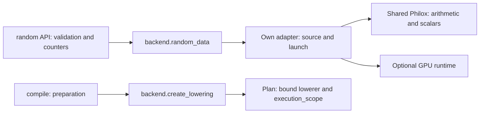

# Implementation routing and Vulkan completion — 2026-09-13

Dispatch through backend methods and factories resolved during plan preparation
is adopted. RNG no longer returns to a central name-based selector, its complete
templates are cached, and Vulkan now waits on a reusable fence. A real finalizer
reentrancy failure in its pool is also fixed.

## Architectural decision

The concern about `if backend == ...` is valid when every common operation needs
to know all implementations. RNG had a redundant path: facade → backend method
→ common helper that asked about the backend again. The relevant cost was not
comparing three strings: OpenCL repeated cast substitutions and other APIs rebuilt
source wrappers on every call.

Ownership is now defined as follows:



- `random.py` retains parameters, ranges, per-distribution/dtype capabilities,
  counter reservations, and capture exclusion. Each backend imports its adapter
  directly. `_random.py` receives dialect fragments as immutable data; it knows
  no GPU names, queues, or classes. NumPy uses its reference directly.
- Source LRUs have a 128-entry limit and immutable keys. OpenCL/Vulkan reuse the
  body by dtype/distribution; CUDA includes count because it embeds it in source.
  Seed, counter, bounds, scale, and output are always rebound. Arrays are not
  retained and the Philox stream is unchanged.
- The plan queries the optional `create_lowering()` factory once and binds
  `execution_scope()`. OpenCL/Vulkan provide a lowerer; CUDA/NumPy continue with
  primitives. A failing factory propagates the error; its absence does not switch
  devices. The scope is a fresh context per execution, with cleanup on errors.
- Public name-based selection, dtype/shape validation, and capability decisions
  remain necessary. This iteration neither turns arbitrary classes into public
  plugins nor removes every project condition. `_gemm.py`, `_gemv.py`, `_norm.py`,
  and part of scalar handling retain routing debt. They will migrate as those
  operations expand, with their own controls.

| Alternative | Decision |
| --- | --- |
| Central selector in every operation | Avoid when it duplicates dispatch and requires editing common code for each backend |
| Backend methods and factories | Adopt: direct calls, clear ownership, preparation outside the loop |
| Global registry, singledispatch, or automatic plugins | Do not introduce: the backend already identifies the implementation; these would add another resolution |
| Complete kernel-language IR | Defer: exceeds the problem; retain shared arithmetic and small adapters |

The NumPy API, eager/compile/fuse, independent extras, and explicit hardware/provider
selection are unchanged. No tricks are added to solvers or comparators.

## Vulkan: synchronization and pool

`synchronize()` first submits recorded commands. With nothing pending it returns
without a native wait. With work pending, it submits an empty marker with a
context fence, waits for its signal, resets it, and only then recycles commands,
descriptors, and leases. No fence is created per operation, and convergence
checks are not grouped less frequently. The private `queue` path retains
`vkQueueWaitIdle` for comparisons.

The marker's scope includes preceding commands in the dedicated queue, according
to the [fence signaling specification](https://docs.vulkan.org/spec/latest/chapters/synchronization.html#synchronization-fences-signaling).
Waiting on a fence does not replace host memory visibility: dependency and
readback barriers are retained. Results of
[`vkWaitForFences`](https://docs.vulkan.org/refpages/latest/refpages/source/vkWaitForFences.html)
are also checked through the CFFI table. On submit/wait/reset failure, the instance
retains references and rejects new submissions; it neither retries nor recycles
uncertain resources. Closing it can also propagate the failure: lost-device
recovery remains future work.

The first prolonged control failed with `OrderedDict mutated during iteration`.
A finalizer can return or evict buffers while a Python allocation triggers GC,
even with the RLock held in the same thread. Lookup now uses a key snapshot and
revalidates the chosen capacity. Release detaches the current pool before
iterating over it. CPU regressions simulate both returns and evictions during
iteration and check accounting and absence of double frees. This is a Python
management bug, with no evidence of vendor dependence.

## Measurement method

Windows / RTX 5060 Ti / NVIDIA 616.64 / Python 3.12. Sequential processes per
backend, observed idle conditions for at least 10 s and a 52 °C ceiling before
each process, minimum 0.25 s warm-up per mode, and 31 samples. Samples, p10/p90,
telemetry, sources, and historical reference are saved. Idling does not guarantee
a sustained thermal regime or eliminate CPU/driver/WDDM variation.

The Vulkan control compares three paths on the same device/context: the previous
wheel's `synchronize` method, queue waiting that skips empty work, and a fence.
Kernels, the corrected pool, and scheduling are common. Two rounds with seeds
941/942 plus confirmation with 117: **144 configurations**, with resident and,
where applicable, full timings. Instrumented measurements are separate: wall
time minus GPU timestamps is not interpreted as “pure Python time.”

The RNG control changes only `random_data` on the same backend and preserves
kernels/synchronization. It uses the Vulkan queue path in both arms, before
promoting the fence; its gains must not be added to completion gains. Two rounds
of OpenCL/Vulkan/custom CUDA, float32/64, and sizes 33, 257×129, 1025×1023:
**264 valid configurations and 12 capability exclusions**. Each pair checks exact
output equality as well as error against Philox/NumPy and moments.

## Vulkan results

Resident microseconds; each cell shows the three medians in round order.
The CSV attached to the artifact retains all cases, full timings, and dispersion.
Controls include allocation; downloads deliver data to the host.

| Case | Previous | Queue skipping empty work | Adopted fence |
| --- | ---: | ---: | ---: |
| Sum 33, float32 | 197 / 183 / 199 | 197 / 198 / 199 | 182 / 165 / 176 |
| Download 1, float32 | 151 / 146 / 156 | 135 / 130 / 133 | 125 / 107 / 126 |
| Download 1,048,576, float32 | 1,379 / 1,357 / 1,390 | 1,346 / 1,334 / 1,358 | 1,342 / 1,320 / 1,333 |
| Energy 2049×33, float32 | 235 / 203 / 287 | 229 / 201 / 213 | 201 / 177 / 190 |
| Covariance 1025×65, float32 | 436 / 403 / 421 | 414 / 398 / 430 | 399 / 393 / 408 |
| CG 129, float32 | 11,866 / 10,723 / 11,084 | 12,505 / 10,569 / 11,977 | 11,093 / 10,334 / 10,521 |
| Descent 129, float32 | 22,167 / 19,795 / 20,245 | 21,685 / 20,495 / 22,404 | 19,537 / 18,235 / 20,267 |
| CG 129, float64 | 18,512 / 19,566 / 19,621 | 20,065 / 19,736 / 19,766 | 17,964 / 20,398 / 18,938 |
| Descent 129, float64 | 44,330 / 39,351 / 39,754 | 46,763 / 40,629 / 42,453 | 37,058 / 37,135 / 42,352 |

The short sum improves approximately 7–11% over the previous wait without changing
its kernel. An explicit call on an empty queue, plus the timer's synchronization,
drops from 20–26 µs to 0.7–1.4 µs: it removes redundant work rather than speeding
up GPU computation. Large copies change little. Float64 CG worsens in one round
and float64 descent in confirmation against the historical method. There are
also full-time regressions, for example float64 sum 444→553 µs in round one and
float64 covariance 741→794 µs in round two. They are retained in the CSV.

The fence is adopted for repeated improvements in short operations and mostly
favorable results against the queue alternative that skips empty work. No
universal improvement or achieved physical limit is claimed. The difference
between the two native calls may depend on driver implementation; these numbers
do not separate that effect from host scheduling or prove results on other vendors.

## RNG routing results

The CPU control replaces allocation and launch with stubs to isolate adapter
preparation; 11 samples of 2,000 float32 calls. It measures neither public latency
nor GPU time.

| Backend | Previous preparation, µs | Cached adapter, µs |
| --- | ---: | ---: |
| OpenCL, range across four distributions | 15.5–20.1 | 3.1–3.8 |
| Vulkan | 13.1–14.0 | 10.4–11.2 |
| CUDA | 3.9–4.6 | 3.1–3.9 |

Public sweeps have mixed results. One repeated case was OpenCL float32 random(33):
194→244 µs and 194→233 µs. It was investigated with **21 alternating blocks of
11 samples per mode**, randomizing their order, in additional processes with
observed idle conditions. The same case gave **221→213 µs**; float64
**203→179 µs**. CUDA gave **134→128 µs** and **103→103 µs**. Original results are
retained: the initial regression was not reproduced with that alternation, but
this does not prove that every difference is noise or every regression disappears.

The decision rests on clearer implementation ownership, cheaper preparation,
and numerical equivalence. It is not presented as a general GPU performance win.
In CUDA, the host reduction is less than 1 µs in this control; dispatch and native
work still dominate.

## Error and semantics

RNG pairs produce exactly the same before/after sequence. Against the same-precision
NumPy transform, maximum absolute error was 2.75e-6 and relative L2 error 3.33e-7;
this is not a higher-precision reference for float32 versus float32. Uniforms,
nonfinites, and moments are validated per case.

Solver tolerances, checking frequency, algorithm, and iterations did not change:

| Application | Iterations | True residual norm / limit | Relative solution error |
| --- | ---: | ---: | ---: |
| CG float32 | 13 | 6.331e-4 / 8.970e-4 | 1.746e-4 |
| Descent float32 | 29 | 8.554e-4 / 8.970e-4 | 3.780e-4 |
| CG float64 | 23 | 5.025e-7 / 8.970e-7 | 1.390e-7 |
| Descent float64 | 59 | 7.819e-7 / 8.970e-7 | 3.519e-7 |

Residuals are recalculated on CPU in float64. Solution error is compared with
float64 `numpy.linalg.solve`, not an arbitrary-precision oracle. The stopping
criterion controls residual, so relative solution error can exceed rtol.
Sum/energy/covariance timings and errors are also retained per case.

## Artifacts and reproduction

Local artifacts: `.artifacts/routing-completion/`. `before.whl` is the wheel from
the staging/RNG round; the SHA of each control module is saved.
`completion-control` is the failed batch and is excluded. `completion-control-v2`
and `completion-confirmation` contain valid rounds. `corrected-completion`
corrects only idle/download reference metadata from the first control, retaining
the original/SHA: timings and errors do not change. `completion-summary.csv` and
`routing-summary.csv` contain all rows and dispersion; `summary.txt` supports
quick inspection.

```powershell
# Configure glslang, runtimes, and the local historical wheel path beforehand.
python -m benchmarks.isolated --worker completion --backends vulkan --rounds 2 --repeats 31 --max-temperature 52 --control-wheel PATH_TO_WHEEL --output NEW_COMPLETION_DIR
python -m benchmarks.isolated --worker routing --backends opencl,vulkan,cuda-custom --rounds 2 --repeats 31 --max-temperature 52 --control-wheel PATH_TO_WHEEL --output NEW_ROUTING_DIR
python -m benchmarks.routing_host --control-wheel PATH_TO_WHEEL --output NEW_HOST_JSON
```

Control workers explicitly execute the trusted local wheel module; they do not
download code. The additional `interleaved.py` script remains in the artifact
with its JSON files to reproduce the specific diagnosis. Final verification of
tests, packaging, and dependencies is in [verification.md](verification.md).

## Next useful improvements

1. Fuse submission and completion marker when work has not yet been submitted,
   without adding fences per dispatch. Profile the native recorder only if
   remaining Python preparation justifies it.
2. Continue logical transposes/flags, GEMV/DOT, and custom kernels with controls
   by shape/dtype and precision; migrate routing when touching each operation.
3. Model operation capabilities and future CUDA fusion on the factories already
   available. A general plugin framework is unnecessary for the next step.
4. Expand RNG only as P2: unbiased integers, streams/spawn, and extensive
   statistical suites. Its arithmetic and stateful effects remain outside compile.
